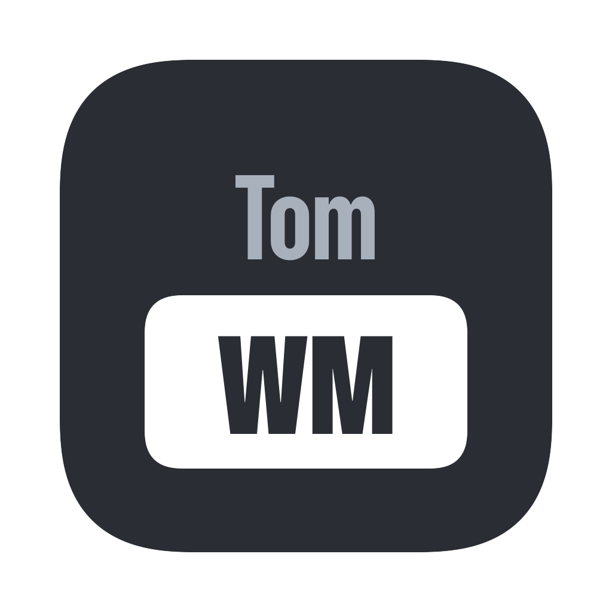
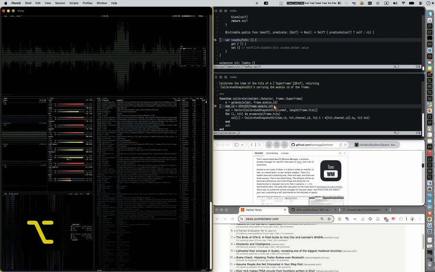

# tomwm



**T**om's **o**pinionated **m**acOS **W**indow **M**anager. A dynamic window manager for macOS in the
spirit of [dwm](https://dwm.suckless.org/), with a bit of ommmmm.

tomwm is not a port of dwm, it is dwm's model on macOS: no tree, no nested splits, no per-window
weights. There is a master area and a stacking area, there are tags, and there are three layouts.
That is the whole thing. The defaults will be my personal preferences and some things will simply
be not implemented or changed (sorry for that in advance ;) -> it's opinionated haha.
The jump start was given by the code base of
[AeroSpace by Nikita Bobko](https://github.com/nikitabobko/AeroSpace), which was my
preferred window manager for the past years.
Feel free to fork and make it your own, everything is MIT and stands on the shoulder of giants.



## The model

**Master and stack.** The master area holds the window that needs your attention right now. Every
other window goes into the stacking area beside it. `zoom` promotes the focused window to master;
on the master it swaps with the next window, so the binding is its own undo. `nmaster` decides how
many windows the master area holds, `mfact` how wide it is.

**Layouts.** Three, per monitor:

| Layout     | Symbol | What it does                                          |
|------------|--------|-------------------------------------------------------|
| `tile`     | `[]=`  | master area on the left, stack on the right           |
| `monocle`  | `[M]`  | every window maximised to the screen                  |
| `floating` | `><>`  | windows keep whatever position and size you give them |

**Tags.** Windows are grouped by tags, not by workspaces. A window carries one or more tags, and a
monitor shows every window carrying at least one of the tags selected on it, so a window can appear
in several views at once. Tags are per monitor, as in dwm. The defaults are named
`base web dev doc img vid mus eml foo`; change them with the `tags` config option.

**Dialogs always float.** Whatever the layout, a dialog is managed floating and is never tiled.
What counts as a dialog is decided by an Accessibility heuristic, checked against a corpus of
recorded window dumps in `axDumps/`.

## Key bindings

`alt` is the modifier throughout. All of this is just a config file; edit `~/.tomwm.toml` to taste.

### Spawning

| Binding           | Action                                      |
|-------------------|---------------------------------------------|
| `alt-shift-enter` | new terminal window (iTerm2, else Terminal) |
| `alt-shift-s`     | new Safari window                           |
| `alt-shift-c`     | new Chrome window                           |
| `alt-shift-f`     | new Finder window                           |
| `alt-shift-m`     | the Mail app                                |
| `alt-shift-a`     | new iTerm2 window running `aerc`            |
| `alt-shift-n`     | the Notes app                               |
| `alt-shift-e`     | the Calendar app                            |
| `alt-shift-r`     | Rocket.Chat                                 |
| `alt-shift-l`     | the Claude app                              |

### Windows

| Binding       | Action                                                        |
|---------------|---------------------------------------------------------------|
| `alt-j`       | focus the next window in the stack                             |
| `alt-k`       | focus the previous window in the stack                         |
| `alt-o`       | focus the master, or go back to the last stack window          |
| `alt-shift-j` | move the focused window down the stack                         |
| `alt-shift-k` | move the focused window up the stack                           |
| `alt-enter`   | `zoom`: promote the focused window to master, or swap it back  |
| `alt-h`       | shrink the master area                                         |
| `alt-l`       | grow the master area                                           |
| `alt-i`       | one more window in the master area                             |
| `alt-d`       | one fewer window in the master area                            |

### Layouts

| Binding           | Action                              |
|-------------------|-------------------------------------|
| `alt-t`           | tile                                |
| `alt-m`           | monocle                             |
| `alt-f`           | floating                            |
| `alt-space`       | back to the previously used layout  |
| `alt-shift-space` | float or unfloat the focused window |

### Tags

Bindings address tags by **position**, not by name (`view --index 3`), so renaming a tag in the
`tags` list costs nothing. That is what dwm's `TAGKEYS` macro does. On the command line you can use
either: `tomwm view web` and `tomwm view --index 2` are the same thing.

Note that `alt-<n>` **toggles** a tag into the view rather than switching to it, and `alt-ctrl-<n>`
is the one that switches. That is not vanilla dwm; swap the two blocks in the config if you prefer
it the other way round.

Only the first nine tags are bound, because that is how many number keys there are. Up to 32 tags
are supported — bind whatever you like to `--index 10` and up.

| Binding                   | Action                                       |
|---------------------------|----------------------------------------------|
| `alt-1` .. `alt-9`        | add or remove that tag from the view         |
| `alt-ctrl-1` .. `9`       | view only that tag                           |
| `alt-shift-1` .. `9`      | move the focused window to that tag          |
| `alt-ctrl-shift-1` .. `9` | add or remove that tag on the focused window |
| `alt-0`                   | view every tag                               |
| `alt-shift-0`             | give the focused window every tag            |
| `alt-tab`                 | back to the previous view                    |

### Monitors

| Binding       | Action                                          |
|---------------|-------------------------------------------------|
| `alt-,`       | focus the previous monitor                      |
| `alt-.`       | focus the next monitor                          |
| `alt-shift-,` | move the focused window to the previous monitor |
| `alt-shift-.` | move the focused window to the next monitor     |

## Commands

Every binding is a command you can also run from a shell:

```
tomwm view [--toggle] <tag>...      show tags (dwm view / toggleview)
tomwm view [--toggle] --index <n>.. same, by 1-based position in the tags list
tomwm view --all                    show every tag
tomwm view --back-and-forth         return to the previous view
tomwm tag  [--toggle] <tag>...      retag the focused window (dwm tag / toggletag)
tomwm tag  [--toggle] --index <n>.. same, by 1-based position
tomwm zoom                          promote the focused window to master
tomwm focus next|prev               walk the stack (dwm focusstack)
tomwm focus master                  focus the master, or back to the last stack window
tomwm focus left|down|up|right      directional focus, unbound by default
tomwm move next|prev                reorder the focused window in the stack
tomwm nmaster +1|-1|<n>             resize the master area by window count
tomwm mfact +0.05|-0.05|<f>         resize the master area by fraction
tomwm layout tile|monocle|floating  set the layout, or --toggle to go back
tomwm floating                      float or unfloat the focused window
tomwm list-tags                     what is selected, what is occupied
```

`tomwm --help` lists the rest.

## Configuration

Plain TOML at `~/.tomwm.toml` or `$XDG_CONFIG_HOME/tomwm/tomwm.toml`. See
[default-config.toml](./docs/config-examples/default-config.toml) for the shipped defaults and the
[guide](./docs/guide.adoc) for what every option means.

## Building

```
swift build              # builds the tomwm CLI and a debug server binary
swift test               # runs the test suite
./build-debug.sh         # the full debug build, including generated files
./.build/debug/TomWmApp  # run it
```

The debug server binary built by SPM has no app bundle, so it has no Info.plist, no icon and no
code signature, and macOS attributes its Accessibility permission to whichever terminal launched
it. For a real .app use `./build-release.sh`, which drives Xcode.

`./.build/debug/TomWmApp --read-only` tracks and tags windows without ever moving them, which is
useful for poking at the model with the query commands.

## Status

Early. The window model, the layouts, the tag system and the command surface are in place; expect
rough edges everywhere else. Multi-monitor behaviour in particular has code but no test coverage.

## Credits

tomwm got its jump start from [AeroSpace](https://github.com/nikitabobko/AeroSpace) by Nikita Bobko,
and began life as a full copy of it. Everything that makes a macOS window manager possible at all
came from there: the Accessibility API layer with its per-application run loops, the window and
application lifecycle handling, the TOML configuration system, the CLI/server IPC, the monitor
handling, the dialog classification heuristic with its recorded test fixtures, and the build setup.
tomwm keeps that plumbing and replaces AeroSpace's i3-style tree with dwm's client model. It is a
large debt and a gladly acknowledged one. Many thanks Nikita! `:)`

dwm itself, by [suckless.org](https://suckless.org/), is the design tomwm is copying.

## License

MIT. See [LICENSE.txt](./LICENSE.txt) and [legal/README.md](./legal/README.md) for bundled
dependencies.
